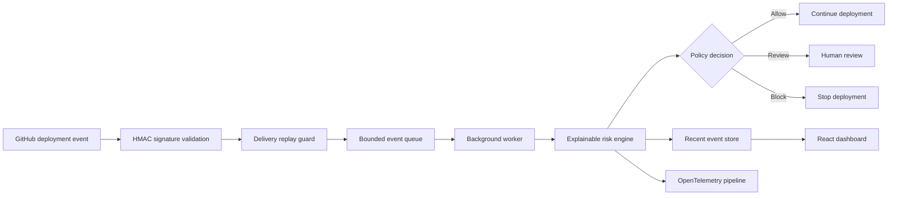

# ReleaseScope

**Explainable deployment risk intelligence for modern engineering teams.**

ReleaseScope evaluates deployment signals before production, produces an auditable risk score, and explains exactly why a release should proceed, require review, or be blocked.

This is a clean-room portfolio project. All code, rules, names, and demo data were created from scratch. It contains no employer code, data, schemas, credentials, or proprietary business rules.

## Why this exists

Deployment decisions are often based on a green pipeline alone. ReleaseScope combines change size, test outcomes, incident history, critical dependencies, performance regression, security findings, coverage, and rollback readiness into one explainable decision.

```text
Deployment risk = change surface
                + failed tests
                + incident history
                + critical components
                + performance regression
                + security findings
                - test coverage
                - rollback readiness
```

## Current capabilities

- .NET 10 Minimal API with OpenAPI and health checks.
- Deterministic, explainable risk-scoring domain engine.
- Allow, review, and block decisions with auditable factors.
- Signed GitHub deployment webhooks with constant-time HMAC validation.
- Replay protection and bounded asynchronous event processing.
- Rate limiting, Problem Details, and explicit CORS policy.
- React and TypeScript operations dashboard.
- Generated demo deployments with no external dependencies.
- Automated domain tests covering decisions and protective controls.
- Docker Compose and GitHub Actions CI.

## Architecture



The current milestone keeps infrastructure deliberately small so the security and risk model remain easy to review. The queue, replay guard, and processed-event store are intentionally in memory. The next event-driven milestone will add durable ingestion, idempotent consumers, OpenTelemetry collectors, and failure injection without changing the domain contract.

## Engineering approach

Development uses an AI-assisted workflow to accelerate implementation and review. Architecture, domain rules, security boundaries, and validation are treated as explicit engineering decisions. Generated suggestions are not accepted without compilation, automated tests, and visual verification.

## Run locally

### Backend

```powershell
dotnet run --project src/ReleaseScope.Api
```

The API is available at `http://localhost:5080`:

- `GET /api/dashboard`
- `GET /api/deployments`
- `POST /api/assessments`
- `POST /api/webhooks/github`
- `GET /api/webhooks/events`
- `GET /api/webhooks/events/{deliveryId}`
- `GET /health`

To enable GitHub webhook ingestion, configure the secret outside source control:

```powershell
$env:GitHubWebhook__Secret = "replace-with-a-random-webhook-secret"
dotnet run --project src/ReleaseScope.Api
```

Register a GitHub webhook for the `deployment` event, use `application/json`, and point it to `/api/webhooks/github`. See [the webhook guide](docs/WEBHOOKS.md) for the request contract and local verification steps.

### Frontend

```powershell
cd web
pnpm install
pnpm dev
```

Open `http://localhost:5173`. The dashboard uses generated fallback data when the API is unavailable, which keeps visual review deterministic.

### Docker

```powershell
docker compose up --build
```

## Test

```powershell
dotnet test ReleaseScope.slnx
cd web
pnpm build
```

## Roadmap

- [x] Explainable deployment risk engine.
- [x] Operations dashboard and deterministic demo.
- [x] CI, containers, health checks, and rate limiting.
- [x] Signed GitHub webhook ingestion and replay protection.
- [x] Bounded in-memory event processing.
- [ ] RabbitMQ outbox and idempotent consumers.
- [ ] SQL Server persistence and Redis caching.
- [ ] .NET Aspire orchestration.
- [ ] OpenTelemetry, Prometheus, Tempo, and Grafana.
- [ ] Canary analysis, rollback simulation, and load testing.
- [ ] Optional provider-agnostic AI incident summary.

## Content strategy

The project is also structured as an eight-part engineering series covering explainability, architecture, webhook security, distributed tracing, failure injection, and performance. See [the content plan](docs/CONTENT_PLAN.md).

The first four publication drafts are available in [`docs/posts`](docs/posts).

## License

MIT
